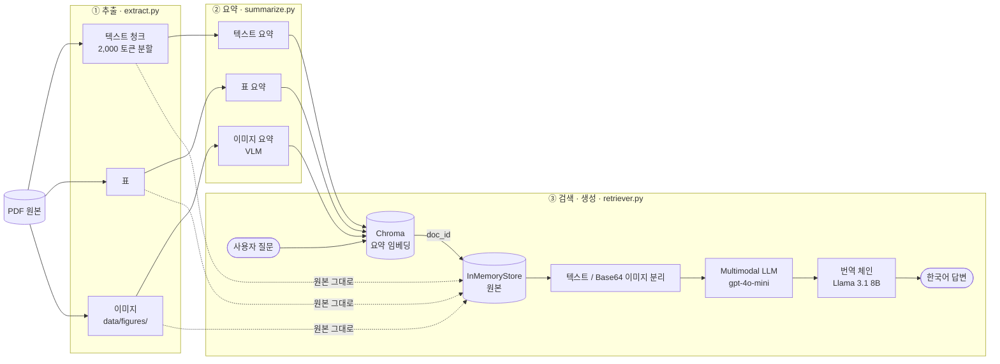

# Multimodal RAG — <!-- TODO: PDF 제목 --> 문서 질의응답

> 텍스트·표·차트가 섞인 PDF에서 **"표와 그래프 안에만 있는 정보"까지 답할 수 있는** RAG 시스템

<!-- TODO: 한 줄 결과 요약. 예) "텍스트 RAG가 답하지 못한 수치 질문 5건 중 N건을 멀티모달 RAG가 근거와 함께 답변" -->

---

## 1. 문제 정의

**대상 문서:** <!-- TODO: 문서명, 발행처, 연도, 페이지 수, 출처 링크 -->
- 분량: <!-- TODO: N 페이지 -->
- 구성: 텍스트 <!-- TODO --> / 표 <!-- TODO: N개 --> / 그래프·이미지 <!-- TODO: N개 -->

**문제:** 이 문서의 핵심 정보는 <!-- TODO: 예) 연도별 매출 추이, 지역별 비중 --> 처럼 **표와 차트 안에만 존재**합니다.
본문 텍스트는 "전년 대비 증가했다" 정도로만 서술하고 구체적인 수치는 표·그래프로 넘깁니다.
따라서 텍스트만 임베딩하는 일반 RAG는

1. 표가 셀 단위로 깨진 문자열로 추출되어 의미 있는 검색이 되지 않고,
2. 그래프는 아예 추출되지 않아 **검색 대상에서 사라집니다.**

**목표:** 텍스트·표·이미지를 모두 검색 가능하게 만들고, 답변 시에는 원본(표 원문, 이미지 자체)을 LLM에 넘겨 **수치까지 정확한 답변**을 생성합니다.

---

## 2. 아키텍처



### 왜 "요약으로 검색하고, 원본으로 생성"하는가

| 단계 | 사용하는 것 | 이유 |
|---|---|---|
| **검색** | 요약 | 표는 숫자·구분자가 나열된 문자열이라 임베딩해도 의미가 잘 잡히지 않고, 이미지는 텍스트 임베딩 자체가 불가능합니다. 요약은 "이 표는 2020~2024년 지역별 매출을 비교한다"처럼 **질문과 같은 언어로 내용을 설명**하므로 질문과의 유사도 검색이 잘 됩니다. |
| **생성** | 원본 | 요약은 압축 과정에서 **구체적인 수치·세부 항목이 빠집니다.** 검색으로 찾은 요약의 `doc_id`로 원본 표·이미지를 꺼내 LLM에 넘겨야 "2023년 수치는 얼마인가" 같은 질문에 정확히 답할 수 있습니다. |

즉 요약은 **검색용 색인(인덱스)**, 원본은 **답변용 근거**로 역할을 분리한 구조이며, 이를 LangChain `MultiVectorRetriever`가 `doc_id`로 연결합니다.

---

## 3. 기술 선택 근거

| 항목 | 선택 | 근거 |
|---|---|---|
| PDF 파싱 | `unstructured` `partition_pdf` (`strategy="hi_res"`, `infer_table_structure=True`) | `hi_res`는 레이아웃 분석 모델로 표·그림 영역을 탐지합니다. 이 옵션이 없으면 표가 일반 텍스트로 섞이고 이미지가 추출되지 않아 멀티모달 RAG의 전제가 무너집니다. |
| 1차 청킹 | `by_title`, `max_characters=4000`, `new_after_n_chars=3800`, `combine_text_under_n_chars=2000` | 제목 단위로 주제가 바뀌는 문서라 제목 기준으로 묶으면 한 블록에 한 주제가 담깁니다. 짧은 조각은 합쳐 요약 호출 횟수(비용)를 줄입니다. |
| 2차 분할 | `CharacterTextSplitter.from_tiktoken_encoder(chunk_size=2000, chunk_overlap=200)` | 글자가 아닌 **토큰** 기준으로 잘라 모델 입력 한도를 정확히 관리합니다. 200 토큰을 겹쳐 블록 경계에서 문장이 잘려 의미가 사라지는 것을 막습니다. |
| 텍스트·표 요약 | `gpt-4o-mini`, `temperature=0` | 요약은 청크 수만큼 호출되므로 저렴하고 빠른 모델이 적합합니다. `temperature=0`으로 같은 입력에 같은 요약이 나오게 해 재현성을 확보합니다. |
| 이미지 요약 (VLM) | `gpt-4o-mini` (비전 입력) | 교재의 `gpt-4-vision-preview`는 지원 종료되었습니다. `gpt-4o-mini`는 비전을 지원하면서 비용이 낮습니다. 로컬 대안으로 LLaVA 7B도 구현해 두었습니다. |
| 임베딩 / 저장소 | `OpenAIEmbeddings` + Chroma / `InMemoryStore` | 요약은 Chroma(색인 카드 서랍), 원본은 InMemoryStore(서가)에 같은 `doc_id`로 저장합니다. 둘 다 로컬에서 서버 없이 동작합니다. |
| 동시 요청 | `max_concurrency=5` | 속도와 API Rate Limit 사이의 절충값입니다. `RateLimitError`가 나면 2로 낮춥니다. |
| 답변 생성 | `gpt-4o-mini`, `max_tokens=1024` | 검색된 원본 이미지와 텍스트를 한 메시지에 함께 넣을 수 있는 멀티모달 모델이 필요합니다. |
| 번역 | Ollama `llama3.1:8b` | 번역은 추론 난도가 낮아 로컬 오픈소스 모델로 충분하고, API 비용이 들지 않습니다. |
| 프롬프트 언어 | 텍스트·표 요약: 한국어 프롬프트 / 이미지 요약: 영어 지시 + "한국어로 작성" / 답변: <!-- TODO: 영어로 생성 후 번역 or 한국어 직접 생성 --> | 질문이 한국어이므로 **요약도 한국어여야** 같은 언어끼리 임베딩 유사도가 높아져 검색이 잘 됩니다. 이미지 요약은 VLM이 영어 지시를 더 안정적으로 따르므로 지시는 영어, 출력만 한국어로 지정했습니다. |

<!-- TODO: 위 값 중 실제 노트북과 다른 것이 있으면 수정 -->

---

## 4. 폴더 구조

```
multimodal-rag/
├── .env.example                # API 키 템플릿 (실제 키 없음)
├── .gitignore
├── requirements.txt            # 직접 관리하는 의존성 목록
├── requirements.lock.txt       # 버전 고정 목록 (재현용)
├── README.md
├── docs/                       # README용 캡처 이미지
├── data/
│   ├── <!-- TODO -->.pdf       # 원본 PDF (Git 제외, 1장 출처 링크에서 다운로드)
│   └── figures/                # 추출 이미지 (Git 제외, 실행 시 생성)
├── notebooks/
│   └── Multi_modal_RAG.ipynb   # 실행 노트북 (출력 셀 포함)
└── src/
    ├── extract.py              # PDF → 텍스트/표/이미지 분리
    ├── summarize.py            # 요소별 요약 체인
    └── retriever.py            # MultiVectorRetriever 구성 및 RAG 체인
```

---

## 5. 실행 방법

### 사전 준비

| 항목 | 내용 |
|---|---|
| Python | **3.11 또는 3.12** (`unstructured[all-docs]`의 `onnxruntime` 등이 최신 버전 휠을 제공하지 않는 경우가 있음). 개발 환경은 Windows + Python 3.11.9 |
| Poppler | PDF → 이미지 변환. macOS `brew install poppler` / Windows 설치 후 `bin` 폴더 Path 등록 |
| Tesseract | OCR. macOS `brew install tesseract` / Windows `C:\Program Files\Tesseract-OCR` Path 등록 |
| Ollama (선택) | 번역 체인용. `ollama pull llama3.1:8b` |

```bash
pdftoppm -h    # 도움말이 나오면 Poppler OK
tesseract -v   # 버전이 나오면 Tesseract OK
```

> Path 등록 후에는 터미널과 에디터를 완전히 재시작해야 인식됩니다.
> Windows에서는 프로젝트 경로에 **한글이나 공백이 없어야** 합니다. (예: `C:\workspaces\multimodal-rag`)

### 설치

```bash
git clone https://github.com/<!-- TODO: 계정 -->/multimodal-rag.git
cd multimodal-rag

python -m venv .venv
# macOS / Linux
source .venv/bin/activate
# Windows PowerShell
.venv\Scripts\Activate.ps1

python -m pip install --upgrade pip
pip install -r requirements.lock.txt

# 노트북 커널 등록
python -m ipykernel install --user --name multimodal-rag --display-name "Python (multimodal-rag)"
```

> **의존성 관리:** `requirements.txt`는 사람이 직접 읽고 관리하는 **최상위 패키지 목록**이고, `requirements.lock.txt`는 `pip freeze`로 하위 의존성까지 버전을 고정한 **기계가 똑같이 재현하는 목록**입니다. 동일 환경 재현에는 lock 파일을, 패키지 추가·업그레이드 시에는 `requirements.txt`를 수정한 뒤 lock을 다시 생성합니다.

```bash
# 의존성 변경 시 lock 재생성
pip install -r requirements.txt
pip freeze > requirements.lock.txt
```

> **Windows + Python 3.11 주의:** `unstructured[all-docs]`만으로는 PDF 분석에 필요한 `unstructured-inference`가 설치되지 않습니다. 그래서 `requirements.txt`에 `unstructured-inference`를 따로 적어 두었습니다. 자세한 내용은 [7. 트러블슈팅 기록](#7-트러블슈팅-기록)을 참고하세요.

설치 확인:

```bash
python -c "from unstructured.partition.pdf import partition_pdf; print('OK')"
```

### API 키 설정

```bash
cp .env.example .env      # Windows: copy .env.example .env
# .env 파일을 열어 OPENAI_API_KEY 입력
```

설치가 끝났으면 [6. 사용 안내](#6-사용-안내)로 넘어가세요.

---

## 6. 사용 안내

### 6-1. 빠른 시작

1. 1장 출처 링크에서 PDF를 받아 `data/`에 넣습니다.
2. VS Code에서 `notebooks/Multi_modal_RAG.ipynb`를 열고, 오른쪽 위 **커널 선택**에서 `Python (multimodal-rag)`를 고릅니다.
3. 맨 위 셀부터 `Shift + Enter`로 **순서대로** 실행합니다. 셀을 건너뛰면 앞에서 만든 변수가 없어 에러가 납니다.
4. 마지막 질의응답 셀에서 `query`를 원하는 질문으로 바꿔 실행합니다.

### 6-2. 노트북 단계별 안내

각 단계가 끝날 때 **정상 결과** 열과 같은지 확인한 뒤 다음 단계로 넘어가세요.

| 단계 | 하는 일 | 정상 결과 | 소요 시간 |
|---|---|---|---|
| 0. 환경 검증 | Python·Poppler·Tesseract·패키지 확인 | 모든 항목 `OK` | 즉시 |
| 1. 데이터 추출 | `partition_pdf`로 텍스트·표·이미지 분리 | `data/figures/`에 이미지 파일 생성, `len(texts) > 0` | 2~3분 (첫 실행은 모델 다운로드로 더 걸림) |
| 2. 텍스트·표 요약 | `gpt-4o-mini`로 청크·표 요약 | `text_summaries[0]`에 한국어 요약문 출력 | 1~2분 |
| 3. 이미지 요약 | 이미지를 Base64로 바꿔 VLM으로 요약 | `image_summaries[0]`이 실제 그림 내용과 일치 | 이미지 수에 비례 |
| 4. 검색기 구성 | 요약은 Chroma, 원본은 InMemoryStore에 같은 `doc_id`로 저장 | 에러 없이 완료 | 수 초 |
| 5. 질의응답 | 질문 → 요약 검색 → 원본으로 답변 생성 | 표·그래프 내용이 들어간 답변 | 수 초 |
| 6. 번역 (선택) | 답변을 로컬 Llama 3.1로 한국어 번역 | 한국어 답변 | 수 초 (Ollama 실행 필요) |

> `table_summaries`가 `[]`로 나와도 PDF에 표 객체가 없거나 표가 이미지로 들어간 경우라면 정상입니다.

### 6-3. 질문하기

```python
query = "2023년 하반기 매출 추세를 그래프 기준으로 설명해줘"
print(chain.invoke(query))
```

답변의 근거가 무엇이었는지 확인하려면 검색 결과를 직접 봅니다.

```python
docs = retriever.invoke(query)
found = split_image_text_types(docs)
print("이미지 근거:", len(found["images"]), "개")
print("텍스트·표 근거:", len(found["texts"]), "개")
print(found["texts"][0][:300] if found["texts"] else "")
```

**좋은 질문 예시:** 본문에는 없고 표나 그래프에만 있는 수치·비교·추세를 묻는 질문. 멀티모달 RAG의 차이가 가장 잘 드러납니다.

### 6-4. 다른 PDF로 바꿔 쓰기

1. 새 PDF를 `data/`에 넣습니다. 파일 이름은 **영문 소문자와 밑줄**로 짓습니다. (한글·공백은 파싱 오류 원인)
2. 노트북의 `fname = "..."`을 새 파일 이름으로 바꿉니다.
3. `data/figures/` 안의 기존 이미지를 지웁니다. 이미지 요약은 폴더 안의 **모든** 이미지를 읽기 때문에, 남아 있으면 이전 문서의 그림이 섞입니다.
4. 커널을 재시작하고 처음부터 실행합니다. 검색기가 메모리에 이전 문서를 들고 있지 않게 하기 위해서입니다.

### 6-5. 비용과 시간 참고

- LLM 호출 수 = **텍스트 청크 수 + 표 수 + 이미지 수** (요약) + 질문 수 (답변). 페이지가 많을수록 비용이 늘어나니 10~30페이지 문서를 권장합니다.
- `RateLimitError`가 나면 요약 함수의 `max_concurrency`를 5에서 2로 낮춥니다.

### 6-6. 자주 나는 문제

| 증상 | 해결 |
|---|---|
| `ModuleNotFoundError: unstructured_inference` | [7. 트러블슈팅 기록](#7-트러블슈팅-기록) 참고 |
| `PDFInfoNotInstalledError` / `TesseractNotFoundError` | Poppler·Tesseract Path 등록 후 터미널·에디터 완전 재시작 |
| `data/figures/`가 비어 있음 | `strategy="hi_res"`와 이미지 추출 옵션이 켜져 있는지, 저장 경로와 읽는 경로가 같은지 확인 |
| `AuthenticationError` | `.env`의 키 앞뒤 공백·따옴표 제거, `load_dotenv()` 실행 여부 확인 |
| 번역 셀에서 연결 오류 | Ollama가 실행 중인지 확인하고 `ollama pull llama3.1:8b`로 모델을 받았는지 확인 |
| 노트북에서 `ModuleNotFoundError` | 커널이 `Python (multimodal-rag)`인지 확인 |

---

## 7. 트러블슈팅 기록

### `ModuleNotFoundError: No module named 'unstructured_inference'`

**증상:** `pip install "unstructured[all-docs]"`가 오류 없이 끝났는데, `from unstructured.partition.pdf import partition_pdf`에서 위 에러가 발생했습니다. 다시 설치해도 pip는 "Requirement already satisfied"만 출력하고 결과가 같았습니다.

**원인 추적:**

```bash
# 1) 설치 여부 확인 → "Package(s) not found"
pip show unstructured-inference

# 2) unstructured가 어떤 조건에서 이 패키지를 설치하는지 확인
python -c "import importlib.metadata as m; [print(r) for r in m.requires('unstructured') if 'unstructured-inference' in r]"
```

2번 결과에서 다음 조건을 확인했습니다.

```
unstructured-inference ...; (platform_system == 'Windows' and python_version >= '3.12' and python_version < '3.13') and extra == 'pdf'
```

`unstructured` 0.27.x는 **Windows에서는 Python 3.12일 때만** `unstructured-inference`를 함께 설치합니다. 개발 환경이 Windows + Python 3.11이라 pip가 조건에 맞지 않는다고 판단해 조용히 건너뛴 것이었습니다. 설치 실패가 아니라 **설치 대상에서 제외**된 것이라 에러 메시지가 없었습니다.

**해결:** `requirements.txt`에 버전 범위를 맞춰 명시적으로 추가하고 lock을 다시 생성했습니다.

```
unstructured-inference>=1.6.12,<2
```

버전 범위는 `unstructured`가 요구하는 범위(`>=1.6.12,<2`)를 그대로 따랐습니다. 대안으로 가상환경을 Python 3.12로 다시 만드는 방법도 있지만, 기존 환경을 유지하면서 한 줄로 해결되는 쪽을 택했습니다.

**배운 점:** pip의 "이미 설치됨" 메시지는 **조건에 맞는 패키지가 모두 설치됨**이라는 뜻이지, extra에 적힌 패키지가 전부 설치됐다는 뜻이 아닙니다. 패키지 메타데이터의 환경 조건(environment marker)을 확인해야 원인을 찾을 수 있습니다.

---

## 8. 보안 처리

- API 키는 `.env`에만 저장하고 `python-dotenv`로 로드합니다. 코드·노트북에 키 문자열을 직접 쓰지 않습니다.
- 저장소에는 키가 비어 있는 `.env.example`만 포함합니다.
- `.gitignore`로 제외하는 항목:

| 항목 | 이유 |
|---|---|
| `.env` | API 키 |
| `.venv/` | 가상환경 (용량 큼, OS마다 다름) |
| `data/figures/` | 추출 이미지 (실행 시 재생성 가능, 용량 큼) |
| `*.pdf` | 원본 문서 (용량·저작권. 출처 링크로 대체) |
| `chroma_db/` | 벡터 DB (실행 시 재생성 가능) |
| `__pycache__/`, `*.py[cod]` | 실행 부산물 |
| `.ipynb_checkpoints/` | 노트북 자동 저장본 |
| `.vscode/`, `.idea/`, `.DS_Store` | 개인 에디터·OS 설정 |

---

## 9. Before / After 비교

같은 질문을 **텍스트 전용 RAG**와 **멀티모달 RAG**에 던진 결과입니다.

- **Before (텍스트 RAG):** `texts_2k_token`만 요약 없이 그대로 Chroma에 임베딩하고, 검색된 텍스트만 `gpt-4o-mini`에 전달
- **After (멀티모달 RAG):** 텍스트·표·이미지 요약으로 검색하고, 원본 텍스트·표·이미지를 함께 전달

**질문:** <!-- TODO: 표/그래프에만 답이 있는 질문 -->

| 텍스트 RAG (Before) | 멀티모달 RAG (After) |
|---|---|
|  |  |

**차이 설명:**
<!-- TODO: 예) 텍스트 RAG는 본문의 "증가 추세" 서술만 찾아 구체적인 수치 없이 답변했다. 멀티모달 RAG는 그래프 요약이 검색되어 원본 이미지가 LLM에 전달됐고, 차트에서 2023년 값을 직접 읽어 답변했다. -->

---

## 10. 질의응답 5건

| # | 질문 | 답변 (요약) | 근거 원본 종류 |
|---|---|---|---|
| 1 | <!-- TODO --> | <!-- TODO --> | 텍스트 |
| 2 | <!-- TODO --> | <!-- TODO --> | 표 |
| 3 | <!-- TODO --> | <!-- TODO --> | 표 |
| 4 | <!-- TODO --> | <!-- TODO --> | 이미지(그래프) |
| 5 | <!-- TODO --> | <!-- TODO --> | 이미지 + 텍스트 |

---

## 11. 한계점

- **요약 비용:** 모든 청크·표·이미지마다 LLM 호출이 발생해 문서가 길어지면 비용과 시간이 비례해 증가합니다.
- **표 추출 오류:** 병합 셀이나 여러 페이지에 걸친 표는 구조가 깨져 추출될 수 있고, 이미지로 삽입된 표는 `Table`로 잡히지 않습니다.
- **차트 수치 판독:** 비전 모델이 막대·선 그래프의 값을 눈금으로 추정하기 때문에 라벨이 없는 수치는 오차가 생길 수 있습니다.
- **요약 단계의 정보 손실:** 요약에 언급되지 않은 세부 항목은 검색 자체가 되지 않습니다. (원본은 생성 단계에서만 쓰이므로)
- **docstore 비영속성:** `InMemoryStore`는 커널 재시작 시 사라져 요약부터 다시 만들어야 합니다.
- **번역 품질:** 8B 로컬 모델은 전문 용어나 숫자 단위를 바꾸는 경우가 있어, 프롬프트에 "숫자와 고유명사는 그대로"를 명시했습니다.
- **환경 의존성:** `unstructured`의 PDF 분석 의존성은 OS·Python 버전 조합에 따라 설치 여부가 달라집니다. Windows + Python 3.11 / 3.12 외의 조합은 검증하지 않았습니다.
- **정성 평가만 수행:** 5건의 질의로 확인했을 뿐, 정답셋 기반의 정량 평가(정확도, 검색 재현율)는 하지 않았습니다.

### 개선 방향
- docstore를 파일/DB 기반으로 바꿔 요약 결과 재사용
- 표는 요약과 함께 원본 텍스트도 임베딩하는 하이브리드 검색
- 질의-정답 쌍을 만들어 RAGAS 등으로 정량 평가
