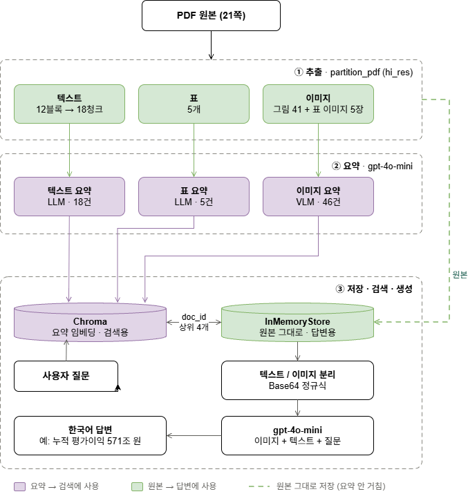
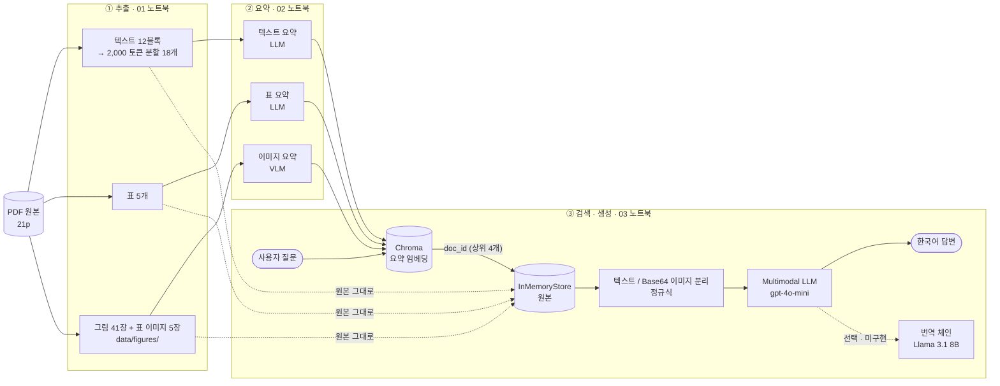
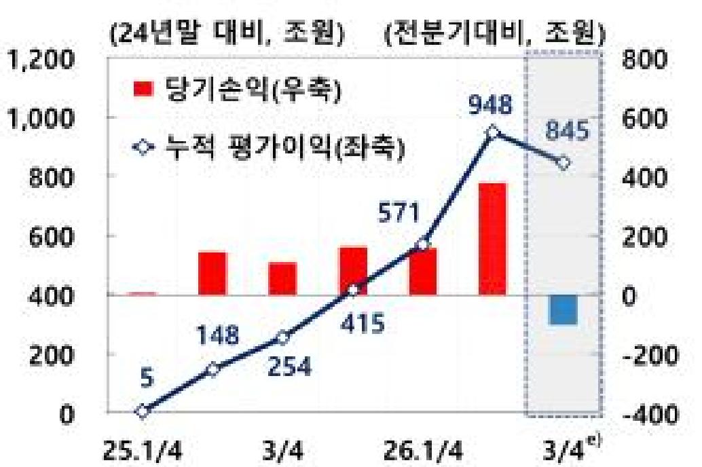
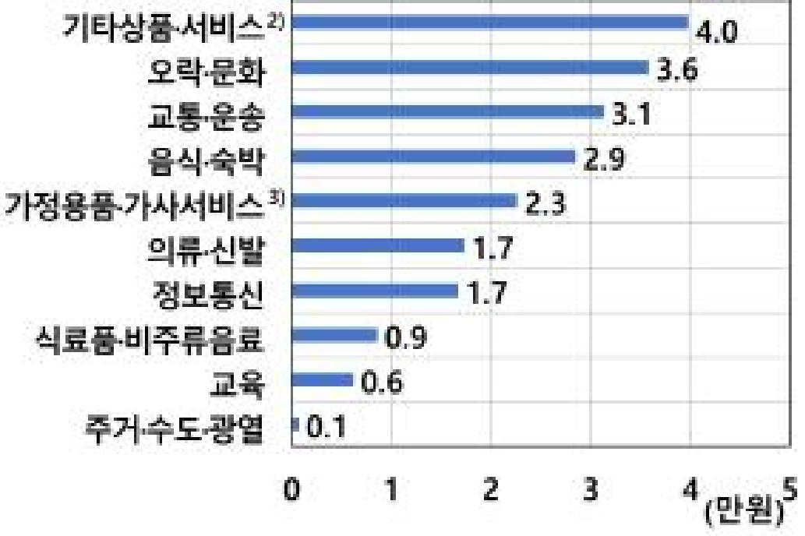
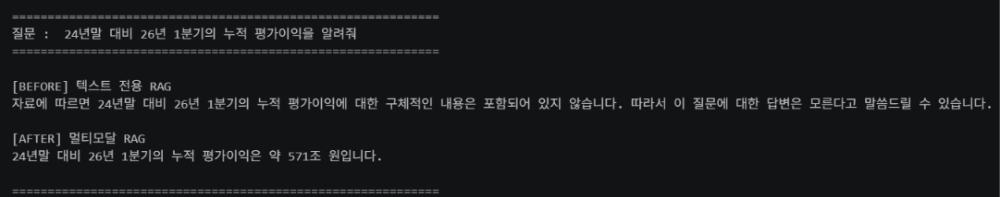

# Multimodal RAG — 한국은행 「경제상황 평가(2026년 10월)」 문서 질의응답

> 텍스트·표·차트가 섞인 PDF에서 **"표와 그래프 안에만 있는 정보"까지 답할 수 있는** RAG 시스템

**결과:** 그래프에만 있는 수치를 물었을 때 텍스트 RAG는 "모른다"고 답했고, 멀티모달 RAG는 그래프 원본을 읽어 **정확한 값(571조원)** 으로 답했습니다. → [10. Before / After](#10-before--after-비교)

---

## 1. 문제 정의

**대상 문서:** 한국은행 보도자료 「경제상황 평가(2026년 10월)」 (공보 2026-10-17호, 2026.10.22 배포)
- 출처: [한국은행 › 뉴스/자료 › 간행물 › 경제상황 평가(2026.10월)](https://www.bok.or.kr/portal/bbs/P0002105/view.do?nttId=11065882&menuNo=200439)
- 파일: `data/economy_FFF.pdf`
- 분량: 21페이지
- 추출 결과: 텍스트 블록 12개(토큰 분할 후 18개) / 표 5개 / 그림 이미지 41개 + 표 이미지 5개

**문제:** 이 문서의 핵심 정보는 가계 주식 누적 평가이익, 품목별 소비 증가액, 유가 전망치처럼 **표와 차트 안에 담겨 있습니다.**
본문 텍스트는 "기존 전망경로를 상회하는 높은 성장세" 처럼 방향만 서술하고 구체적인 수치는 표·그래프로 넘깁니다.
따라서 텍스트만 임베딩하는 일반 RAG는

1. 표가 셀 단위로 깨진 문자열로 추출되어 의미 있는 검색이 되지 않고,
2. 그래프는 아예 추출되지 않아 **검색 대상에서 사라집니다.**

**목표:** 텍스트·표·이미지를 모두 검색 가능하게 만들고, 답변 시에는 원본(표 원문, 이미지 자체)을 LLM에 넘겨 **수치까지 정확한 답변**을 생성합니다.

---

## 2. 아키텍처



- **초록(원본):** 추출한 텍스트·표·이미지. 요약을 거치지 않고 **점선**으로 InMemoryStore에 그대로 저장되며, 답변 생성에 쓰입니다.
- **보라(요약):** LLM·VLM이 만든 요약. Chroma에 임베딩되어 **검색**에 쓰입니다.
- **`doc_id`:** 요약과 원본을 잇는 번호표. 질문으로 찾은 요약 상위 4개의 `doc_id`로 원본을 꺼내 `gpt-4o-mini`에 넘깁니다.

<details>
<summary>Mermaid 버전 (텍스트 다이어그램)</summary>



</details>

단계 사이의 결과는 `pickle`로 저장해 다음 노트북에서 이어 씁니다.

```
PDF ──① 추출──▶ extracted.pkl ──② 요약──▶ summaries.pkl ──③ 검색·생성──▶ 답변
```

### 왜 "요약으로 검색하고, 원본으로 생성"하는가

| 단계 | 사용하는 것 | 이유 |
|---|---|---|
| **검색** | 요약 | 그래프 이미지는 그 자체로는 텍스트 임베딩을 할 수 없어서, 그냥 두면 검색 대상에서 빠집니다. 그래서 VLM으로 그래프를 "2024년 말 대비 … 누적 평균이익을 표시 … 25.1/4에서 26.1/4까지 변화량"처럼 **글로 요약해 벡터 DB에 넣었고**, 그래서 "24년말 대비 누적 평가이익" 질문으로 이 그래프를 찾을 수 있었습니다. (요약에 "평가이익"이 "평균이익"으로 잘못 적혔는데도 나머지 단어가 겹쳐 검색됐습니다.) |
| **생성** | 원본 | 그런데 이 그래프의 요약문에는 정작 답인 **"571"이라는 숫자가 없었습니다.** 요약은 줄이는 과정에서 세부 수치가 빠지기 때문입니다. 그래서 찾은 요약의 `doc_id`로 **원본 이미지를 꺼내 모델에게 직접 보여 줬고**, 모델이 그래프에서 571조 원을 읽어 냈습니다. |

정리하면 요약은 원본을 찾기 위한 **책의 청구기호**이고, 원본은 실제로 읽어야 하는 **책**입니다. 청구기호(요약)로 서가에서 책(원본)을 꺼내 와야 정확한 답을 할 수 있고, 이 둘을 같은 `doc_id`로 이어 주는 것이 LangChain `MultiVectorRetriever`입니다.

---

## 3. 기술 선택 근거

| 항목 | 선택 | 근거 |
|---|---|---|
| PDF 파싱 | `unstructured` `partition_pdf` (`strategy="hi_res"`, `infer_table_structure=True`, `extract_image_block_types=["Image", "Table"]`) | `hi_res`는 레이아웃 분석 모델로 표·그림 영역을 탐지합니다. 이 옵션이 없으면 표가 일반 텍스트로 섞이고 이미지가 추출되지 않아 멀티모달 RAG의 전제가 무너집니다. |
| 표 원본 형태 | 텍스트 + **표 이미지** (`"Table"`도 이미지로 잘라냄) | 표를 텍스트로만 뽑으면 2단 머리글(`2025` 아래 `연간 · 4/4`)이 한 줄로 뭉개져 모델이 연도 열을 잘못 짝짓습니다. `text_as_html`도 시험했지만 한글 칸이 OCR로 깨지거나(영어 OCR) 소수점이 빠져(한국어 OCR, 19.3 → 193) 쓰지 않았습니다. 표 이미지는 머리글 구조가 그대로 남아 VLM이 열을 정확히 읽습니다. → [4-5](#4-5-표-이미지-보강-src) |
| 이미지 저장 경로 | `extract_image_block_output_dir=data/figures` | 저장 경로를 명시해, 이미지 요약 단계가 읽는 경로와 반드시 일치시킵니다. (교안의 `image_output_dir_path`는 버전에 따라 무시될 수 있음) |
| 1차 청킹 | `by_title`, `max_characters=4000`, `new_after_n_chars=3800`, `combine_text_under_n_chars=2000` | 제목 단위로 주제가 바뀌는 문서라 제목 기준으로 묶으면 한 블록에 한 주제가 담깁니다. 짧은 조각은 합쳐 요약 호출 횟수(비용)를 줄입니다. |
| 2차 분할 | `CharacterTextSplitter.from_tiktoken_encoder(chunk_size=2000, chunk_overlap=200)` | 글자가 아닌 **토큰** 기준으로 잘라 모델 입력 한도를 정확히 관리합니다. 200 토큰을 겹쳐 블록 경계에서 문장이 잘려 의미가 사라지는 것을 막습니다. |
| 중간 결과 저장 | `pickle` (`extracted.pkl`, `summaries.pkl`) | 추출(`hi_res`)은 수 분, 요약은 API 비용이 듭니다. 결과를 저장해 두고 다음 단계에서 불러 써서 **재실행 시간과 비용을 0으로** 만듭니다. |
| 텍스트·표 요약 | `gpt-4o-mini`, `temperature=0` | 요약은 청크 수만큼 호출되므로 저렴하고 빠른 모델이 적합합니다. `temperature=0`으로 같은 입력에 같은 요약이 나오게 해 일관성을 확보합니다. |
| 이미지 요약 (VLM) | `gpt-4o-mini` (비전 입력) | 교재의 `gpt-4-vision-preview`는 지원 종료되었습니다. `gpt-4o-mini`는 비전을 지원하면서 비용이 낮습니다. 로컬 대안으로 LLaVA 7B 코드도 학습했습니다. |
| 임베딩 / 저장소 | `OpenAIEmbeddings` + Chroma / `InMemoryStore` | 요약은 Chroma(색인 카드 서랍), 원본은 InMemoryStore(서가)에 같은 `doc_id`로 저장합니다. 둘 다 로컬에서 서버 없이 동작합니다. |
| 동시 요청 | `max_concurrency=5` | 속도와 API Rate Limit 사이의 절충값입니다. `RateLimitError`가 나면 2로 낮춥니다. |
| 연결 키 | `uuid.uuid4()` → `doc_id` | 요약과 원본에 겹치지 않는 같은 번호표를 붙여, 검색된 요약에서 원본을 정확히 꺼내게 합니다. |
| 검색 개수 | `MultiVectorRetriever` 기본값 k=4 | 비교용 텍스트 RAG도 `k=4`로 맞춰 **검색 개수 차이가 아닌 데이터 종류 차이만** 비교되게 했습니다. |
| 이미지/텍스트 구분 | 정규식 `^[A-Za-z0-9+/]{100,}={0,2}$` | docstore에는 텍스트·표·Base64 이미지가 모두 문자열로 섞여 있습니다. Base64 생김새(영숫자·`+`·`/`만 100자 이상, 끝에 `=` 0~2개)로 이미지를 골라 LLM 메시지 형식을 다르게 포장합니다. |
| 답변 생성 | `gpt-4o-mini`, `temperature=0`, `max_tokens=1024` | 검색된 원본 이미지와 텍스트를 한 `HumanMessage`에 함께 넣을 수 있는 멀티모달 모델이 필요합니다. |
| 번역 (선택) | Ollama `llama3.1:8b` | 번역은 추론 난도가 낮아 로컬 모델로 충분하고 API 비용이 들지 않습니다. 다만 답변을 한국어로 직접 생성하므로 이번에는 연결하지 않았습니다. |
| 프롬프트 언어 | 텍스트·표 요약: 한국어 프롬프트 / 이미지 요약: 영어 지시 + "Korean (Hangul)로 작성" / 답변: **한국어 직접 생성** | 질문이 한국어이므로 **요약도 한국어여야** 같은 언어끼리 임베딩 유사도가 높아져 검색이 잘 됩니다. 이미지 요약은 VLM이 영어 지시를 더 안정적으로 따르므로 지시는 영어, 출력만 한국어로 지정했습니다. 답변은 "한국어로 답하고, 자료에 없으면 모른다고 답하라"고 지시해 번역 단계 없이 한 번에 생성합니다. |

---

## 4. 진행 기록 (학습 흐름)

| 단계 | 날짜 | 노트북 | 한 일 | 결과물 |
|---|---|---|---|---|
| 0. 개념·환경 | 11/4 | — | 멀티모달 RAG 개념 정리, Poppler·Tesseract 설치, 가상환경·패키지 구성 | `requirements.txt`, `requirements.lock.txt` |
| 1. Parser 탐색 | 11/4 | — (별도 실습, 저장소 미포함) | Unstructured Parser의 Element 카테고리와 파싱 전략(규칙 기반 vs 모델 기반 `hi_res`) 실습 | — |
| 2. 데이터 추출 | 11/4~11/5 | `01_데이터추출__연습본.ipynb` | `partition_pdf`로 텍스트·표·이미지 분리, 요소 타입 집계, 텍스트 토큰 분할, 결과 저장. 주석만 보고 코드를 처음부터 다시 작성하는 연습도 함께 진행 | `data/figures/`, `data/processed/extracted.pkl` |
| 3. 요약 생성 | 11/5 | `02_요약생성_학습.ipynb` | LCEL 요약 체인, Base64 인코딩, VLM 이미지 요약, 품질 검증, 토큰 측정 | `data/processed/summaries.pkl` |
| 4. 검색기·최종 체인 | 11/6 | `03_임베딩_최종체인_연습.ipynb` | 요약→Chroma, 원본→InMemoryStore를 `doc_id`로 연결, 멀티모달 체인, 텍스트 RAG와 Before/After 비교 | `assets/screenshot.png` |
| 5. 모듈화 | 11/10 | `src/*.py` | 노트북 01~03의 기능을 `extract` · `summarize` · `retriever` 함수로 정리, 터미널에서 단계별 실행 | `src/extract.py`, `src/summarize.py`, `src/retriever.py` |
| 6. 표 이미지 보강 | 11/10 | `src/extract.py` | 표 질문 오답(연도 열 밀림) 원인 분석 → 표도 이미지로 잘라 VLM 요약·원본으로 추가, 질의응답 5건 재실행 | `data/figures/table-*.jpg` 5장 |

### 4-1. 개념 정리 — 일반 RAG vs 멀티모달 RAG

| 구분 | 일반 RAG | 멀티모달 RAG |
|---|---|---|
| 검색 대상 | 텍스트만 | 텍스트 + 표 + 이미지 |
| 버려지는 데이터 | 그래프, 사진, 표 구조 | 없음 |
| 답변 근거 | 텍스트 청크 | 텍스트 청크 + 원본 표 + 원본 이미지 |
| 필요한 모델 | LLM | LLM + VLM(비전 모델) |

- **Unstructured Parser**는 PDF를 `Title`, `NarrativeText`, `Table`, `Image` 등 **라벨이 붙은 요소(Element)** 로 나누는 도구입니다. 요약은 하지 않습니다. 요약은 다음 단계의 LLM·VLM이 맡습니다.
- **파싱 전략:** 규칙 기반(`fast`)은 빠르지만 표·그림을 구분하지 못하고, 모델 기반(`hi_res`)은 느리지만 레이아웃 모델로 표·그림 영역을 정확히 찾습니다. 멀티모달 RAG에는 `hi_res`가 필수입니다.

### 4-2. 데이터 추출 (01 노트북)

`partition_pdf(hi_res)` 내부에서 일어나는 일:

1. Poppler가 각 페이지를 이미지로 변환
2. 레이아웃 모델(`unstructured-inference`)이 제목·본문·표·그림 영역을 탐지
3. 글자 추출 (PDF 내장 텍스트 또는 Tesseract OCR)
4. 표는 행·열 구조를 추론, 그림은 잘라서 `data/figures/`에 저장
5. `by_title` 청킹으로 본문 요소를 `CompositeElement`로 묶음

| 결과 | 값 |
|---|---|
| 텍스트 블록 (`CompositeElement`) | 12개 |
| 표 (`Table`) | 5개 |
| 토큰 분할 후 텍스트 청크 | 18개 |
| 추출 이미지 | 41장 |

**추출된 이미지 예시** (`data/figures/`는 용량 때문에 Git에서 제외해, 대표 2장만 `assets/`에 복사해 두었습니다)

| `figure-16-39.jpg` — 가계 주식 누적 평가이익 | `figure-12-26.jpg` — 추가 소득 시 품목별 소비 증가액 |
|---|---|
|  |  |
| Before/After 질문(571조 원)의 정답이 들어 있는 그래프 | 질의응답 3번(기타상품서비스 4.0만원)의 정답 그래프 |

파일 이름의 숫자는 `figure-페이지-순번`입니다.

**직접 작성하며 발견한 문제:**
- `categorize_elements`에서 `return`이 `for` 문 안에 들여쓰기되어 **첫 요소 하나만 분류하고 끝나는** 버그가 있었습니다. 전체 요소 수와 분류 결과 수가 맞지 않는 것으로 발견했고, `return`을 반복문 밖으로 옮겨 해결했습니다.
- 교안의 `image_output_dir_path`는 이미지 저장 위치와 요약 단계가 읽는 위치가 어긋날 수 있어, `extract_image_block_output_dir`로 경로를 명시했습니다.

### 4-3. 요약 생성 (02 노트북)

**요약 체인 (LCEL 파이프)**

```
{"element": lambda x: x}  →  prompt  →  model  →  StrOutputParser()
       입력 포장              템플릿 적용   LLM 호출      문자열로 꺼내기
```

- `.batch(..., {"max_concurrency": 5})`로 여러 청크를 동시에 요약합니다.
- 이미지는 API가 문자열만 주고받기 때문에 **Base64 문자열로 포장**한 뒤, 하나의 `HumanMessage` 안에 텍스트 지시와 이미지를 함께 넣어 VLM에 보냅니다.
- 이미지마다 **요약문(검색용)과 Base64 원본(답변 생성용)** 을 같은 순서의 두 리스트로 저장합니다. 순서가 같아야 다음 단계에서 같은 `doc_id`로 짝지을 수 있습니다.

| 결과 | 값 |
|---|---|
| 텍스트 요약 | 18건 (21.9초) |
| 표 요약 | 5건 |
| 이미지 요약 | 41건 (121.4초) |
| 텍스트 요약 토큰 (tiktoken 추정) | 입력 13,516 / 출력 4,262 / 합계 17,778 |

**품질 검증에서 확인한 점:**
- 텍스트 요약은 원본의 핵심(성장세, 물가, 불확실성 요인)을 한국어로 잘 담았습니다.
- 표 5개 중 1번은 실제 데이터 표가 아니라 **담당 부서·연락처 목록**이었습니다. 레이아웃 모델이 격자 형태를 표로 인식한 것으로, 검색 품질에는 노이즈입니다.
- 이미지 41장 중에는 **"보도자료" 글자 이미지, 한국은행 로고** 같은 장식용 이미지도 포함되어 요약 비용을 쓰고 검색을 방해할 수 있습니다.
- 개선 아이디어: 이미지 요약 프롬프트에 "축 이름, 수치 범위, 추세를 반드시 포함" + "이미지에서 확인할 수 없는 내용은 추측하지 말 것"을 추가합니다.

### 4-4. 검색기와 최종 체인 (03 노트북)

**전체 흐름**

```
0. 결과 복원      extracted.pkl + summaries.pkl 불러오기 (원본 수 = 요약 수 확인)
2. 검색기 생성    Chroma(요약) + InMemoryStore(원본) + id_key="doc_id" → MultiVectorRetriever
3. 짝짓기        uuid로 doc_id 생성 → 요약은 vectorstore에, 원본은 docstore에 같은 id로 저장
4. 검색 테스트    질문 → 비슷한 요약 4개 → doc_id로 원본 4개 반환
5. 분리          정규식으로 Base64 이미지 / 텍스트·표 나누기
6. 최종 체인      {검색+질문} → img_prompt_func(메시지 조립) → gpt-4o-mini → StrOutputParser
7. 질의 실행      chain.invoke(query)
8. Before/After  텍스트 전용 RAG와 같은 질문으로 비교
```

**핵심 비유 — 도서관 색인 카드**

| 구성 요소 | 비유 | 들어가는 것 | 역할 |
|---|---|---|---|
| `vectorstore` (Chroma) | 색인 카드 서랍 | 요약문 임베딩 | **검색** |
| `docstore` (InMemoryStore) | 서가 | 원본 텍스트·표·Base64 이미지 | **전달** |
| `id_key="doc_id"` | 청구기호 | uuid 문자열 | 둘을 **연결** |

**최종 체인 (LCEL)**

```python
chain = (
    {
        "context": retriever | RunnableLambda(split_image_text_types),  # 검색 → 이미지/텍스트 분리
        "question": RunnablePassthrough(),                              # 질문은 그대로 전달
    }
    | RunnableLambda(img_prompt_func)   # 이미지 먼저, 그다음 지시문·질문·텍스트를 한 메시지로 조립
    | model                             # gpt-4o-mini (비전)
    | StrOutputParser()
)
```

| 결과 | 값 |
|---|---|
| 복원된 원본 / 요약 | 텍스트 18/18, 표 5/5, 이미지 41/41 |
| 검색 결과 (질문: "24년말 대비 26년 1분기의 누적 평가이익") | 원본 4건 = 이미지 3 + 표 1 |
| 답변 생성 시간 | 2.7초 |
| 답변 | "약 571조 원" (그래프 26.1/4 지점 값과 일치) |

> 💡 질문과 글자가 하나도 겹치지 않는 **이미지 원본**이 검색되었습니다. 요약문을 거쳐서 찾았기 때문입니다.

**직접 작성하며 발견한 문제:**
- `img_prompt_func`에서 이미지 블록의 키를 `"img_url"`로 잘못 써서 OpenAI가 `400 Invalid content type` 에러를 냈습니다. → [8. 트러블슈팅](#8-트러블슈팅-기록)
- 같은 함수에서 텍스트 추가와 `return`이 이미지 `for` 문 안에 들어가 있어, 이미지 1장만 넣고 끝나거나 이미지가 0장이면 `None`을 반환했습니다. 01의 `categorize_elements`와 같은 들여쓰기 실수였습니다.
- 그림 제목이 잘린 이미지는 요약에 핵심어가 빠져 검색되지 않았습니다. (예: "삼성전자 주주 구성" 그래프 → 요약에는 "연령대별 비율"만 남음) → [12. 한계점](#12-한계점)

**생각해 볼 질문**

| 질문 | 답 |
|---|---|
| 요약과 원본에 같은 `doc_id`를 안 붙이면? | 요약은 찾아도 원본을 꺼낼 수 없거나 엉뚱한 원본이 나옵니다. 색인 카드에 청구기호가 없어 책을 못 꺼내는 상황입니다. |
| 검색은 요약, 생성은 원본인 이유는? | 요약은 숫자·세부가 빠지거나 틀릴 수 있습니다. 실제로 그래프 요약엔 "571"이 없었지만 원본 이미지를 보여주자 모델이 값을 읽어냈습니다. |
| `InMemoryStore`를 실서비스로 바꾸려면? | docstore는 `LocalFileStore`·Redis·DB로, Chroma는 `persist_directory`로 디스크에 저장해 재시작 후에도 재사용합니다. |

### 4-5. 표 이미지 보강 (src)

**문제:** 질의응답에서 표에 답이 있는 질문은 멀티모달 RAG가 표를 찾고도 **다른 연도의 값을 답했습니다.** (예: 2025년 경상수지를 물었는데 2024년 값 1,000억 달러)

**원인:** 표의 머리글은 2단입니다.

```
           | 2024 |     2025     |            2026
           |      | 연간  | 4/4  | 1/4 | 2/4 | 3/4 | 7월 | 8월 | 9월
```

텍스트로 추출하면 이 구조가 `2025 (전년동기대비, %) 2024 연간 4/4 1/4 2/4 ...`처럼 한 줄로 뭉개집니다. 그래서 모델이 맨 앞 숫자(2024년 값)를 2025년 값으로 잘못 짝지었습니다.

**시도한 방법**

| 방법 | 결과 |
|---|---|
| ① 표를 HTML(`text_as_html`)로 저장 | 표 셀 글자는 OCR로 다시 읽는데 기본 언어가 영어라 한글 칸이 `Abed 28 Ate)`처럼 깨짐 |
| ② ① + `languages=["kor", "eng"]` | 한글은 살아났지만 **소수점이 빠짐** (19.3 → 193, 1,000 → 1.000). 본문 청크 수도 18 → 20으로 바뀌어 기존 요약을 모두 다시 만들어야 함. 위쪽 연도 머리글 줄도 여전히 없음 |
| ③ **표도 이미지로 잘라내기** (`extract_image_block_types=["Image", "Table"]`) | ✅ 채택. 머리글 구조가 그림 그대로 남고, 본문 추출 결과는 바뀌지 않음 |

**적용:** `table-*.jpg` 5장이 `data/figures/`에 추가로 저장되고, 이미지 요약 단계가 폴더 안 이미지를 모두 읽으므로 **표도 그림처럼 VLM 요약(검색용) + 원본 이미지(답변용)** 으로 들어갑니다. 기존 텍스트 표 원본 5개는 그대로 둡니다. 이번에는 이미 만든 요약은 두고 표 이미지 5장의 요약만 추가로 생성했습니다. (요약 호출 64 → 69회)

**결과:** 표 질문 2건(4, 5번)과 추가 사례(9월 두바이유)가 모두 정답으로 바뀌었습니다. → [11. 질의응답](#11-질의응답-5건)

---

## 5. 폴더 구조

```
multimodal-rag/
├── .env.example                          # API 키 템플릿 (실제 키 없음)
├── .gitignore
├── requirements.txt                      # 직접 관리하는 의존성 목록
├── requirements.lock.txt                 # 버전 고정 목록 (재현용)
├── README.md
├── 01_데이터추출__연습본.ipynb             # ① PDF 추출 → extracted.pkl
├── 02_요약생성_학습.ipynb                  # ② 텍스트·표·이미지 요약 → summaries.pkl
├── 03_임베딩_최종체인_연습.ipynb            # ③ 검색기 + 최종 체인 + Before/After
├── assets/                               # README용 이미지
│   ├── diagram.png                       # 아키텍처 다이어그램 (draw.io로 직접 작도)
│   ├── screenshot.png                    # Before/After 실행 결과 캡처
│   └── figure-*.jpg                      # 추출 이미지 예시 2장 (data/figures/에서 복사)
├── data/
│   ├── economy_FFF.pdf                   # 원본 PDF (한국은행 공개 보도자료)
│   ├── figures/                          # 그림 41장 + 표 이미지 5장 (Git 제외, 실행 시 생성)
│   └── processed/                        # (Git 제외, 01·02 실행 시 생성)
│       ├── extracted.pkl                 # texts, tables, texts_2k_token
│       └── summaries.pkl                 # text/table/image 요약 + img_base64_list
├── notebooks/
│   └── Multi_modal_RAG.ipynb             # 참고용 통합 연습 (추출~요약 체인까지, 제출용 실행 결과는 01~03 노트북)
└── src/                                  # 노트북 01~03을 함수로 정리한 모듈
    ├── extract.py                        # ① PDF 추출 → extracted.pkl
    ├── summarize.py                      # ② 텍스트·표·이미지 요약 → summaries.pkl
    └── retriever.py                      # ③ 검색기 + 멀티모달 체인 + 텍스트 RAG 비교
```

---

## 6. 실행 방법

### 사전 준비

| 항목 | 내용 |
|---|---|
| Python | **3.11 또는 3.12** (`unstructured[all-docs]`의 `onnxruntime` 등이 최신 버전 휠을 제공하지 않는 경우가 있음). 개발 환경은 Windows + Python 3.11.9 |
| Poppler | PDF → 이미지 변환. macOS `brew install poppler` / Windows 설치 후 `bin` 폴더 Path 등록 |
| Tesseract | OCR. macOS `brew install tesseract` / Windows `C:\Program Files\Tesseract-OCR` Path 등록 |
| Ollama (선택) | 번역 체인용. `ollama pull llama3.1:8b` |

```bash
pdftoppm -h    # 도움말이 나오면 Poppler OK
tesseract -v   # 버전이 나오면 Tesseract OK
```

> Path 등록 후에는 터미널과 에디터를 완전히 재시작해야 인식됩니다.
> Windows에서는 프로젝트 경로에 **한글이나 공백이 없어야** 합니다. (예: `C:\workspaces\multimodal-rag`)

### 설치

```bash
git clone https://github.com/daui1727/hy-multimodal-rag.git
cd hy-multimodal-rag

python -m venv .venv
# macOS / Linux
source .venv/bin/activate
# Windows PowerShell
.venv\Scripts\Activate.ps1

python -m pip install --upgrade pip
pip install -r requirements.lock.txt

# 노트북 커널 등록
python -m ipykernel install --user --name multimodal-rag --display-name "Python (multimodal-rag)"
```

> **의존성 관리:** `requirements.txt`는 사람이 직접 읽고 관리하는 **최상위 패키지 목록**이고, `requirements.lock.txt`는 `pip freeze`로 하위 의존성까지 버전을 고정한 **기계가 똑같이 재현하는 목록**입니다. 동일 환경 재현에는 lock 파일을, 패키지 추가·업그레이드 시에는 `requirements.txt`를 수정한 뒤 lock을 다시 생성합니다.

```bash
# 의존성 변경 시 lock 재생성
pip install -r requirements.txt
pip freeze > requirements.lock.txt
```

> **Windows + Python 3.11 주의:** `unstructured[all-docs]`만으로는 PDF 분석에 필요한 `unstructured-inference`가 설치되지 않습니다. 그래서 `requirements.txt`에 `unstructured-inference`를 따로 적어 두었습니다. 자세한 내용은 [8. 트러블슈팅 기록](#8-트러블슈팅-기록)을 참고하세요.

설치 확인:

```bash
python -c "from unstructured.partition.pdf import partition_pdf; print('OK')"
```

### API 키 설정

```bash
cp .env.example .env      # Windows: copy .env.example .env
# .env 파일을 열어 OPENAI_API_KEY 입력
```

설치가 끝났으면 [7. 사용 안내](#7-사용-안내)로 넘어가세요.

---

## 7. 사용 안내

### 7-1. 빠른 시작

1. VS Code에서 프로젝트 폴더를 열고, 노트북 오른쪽 위 **커널 선택**에서 `Python (multimodal-rag)`를 고릅니다.
2. 아래 순서대로 노트북을 엽니다. 각 노트북은 앞 노트북이 저장한 `.pkl`을 불러오므로 **순서를 지켜야** 합니다.
   1. `01_데이터추출__연습본.ipynb` → `data/processed/extracted.pkl` 생성
   2. `02_요약생성_학습.ipynb` → `data/processed/summaries.pkl` 생성
   3. `03_임베딩_최종체인_연습.ipynb` → 검색기 구성, 질의응답, Before/After 비교
3. 각 노트북은 맨 위 셀부터 `Shift + Enter`로 **순서대로** 실행합니다. 셀을 건너뛰면 앞에서 만든 변수가 없어 에러가 납니다.

**노트북 없이 터미널로 실행하기** (`src/` 모듈, 프로젝트 루트에서)

```bash
python src/extract.py      # ① 추출 → extracted.pkl (2~3분)
python src/summarize.py    # ② 요약 → summaries.pkl (API 비용 발생)
python src/retriever.py "24년말 대비 26년 1분기의 누적 평가이익을 알려줘"   # ③ Before/After 답변 출력
```

①·② 결과(pkl)가 이미 있으면 ③만 실행하면 됩니다.
`src/extract.py`는 표도 이미지로 잘라내므로(`table-*.jpg`) 이미지가 46장(그림 41 + 표 5)이 되고, 노트북 01은 학습 당시 설정대로 그림 41장만 추출합니다. [11. 질의응답](#11-질의응답-5건)은 `src` 기준 결과입니다.

### 7-2. 노트북 단계별 안내

각 단계가 끝날 때 **정상 결과** 열과 같은지 확인한 뒤 다음 단계로 넘어가세요.

| 단계 | 하는 일 | 정상 결과 | 소요 시간 (이 문서 기준) |
|---|---|---|---|
| 0. 환경 검증 | Python·Poppler·Tesseract·패키지 확인 | 모든 항목 `OK` | 즉시 |
| 1. 데이터 추출 | `partition_pdf`로 텍스트·표·이미지 분리 | `data/figures/`에 이미지 생성, `len(texts) > 0` | 2~3분 (첫 실행은 모델 다운로드로 더 걸림) |
| 2. API 키 확인 | `.env` 로드, 로드 여부만 출력 (키 값 미출력), 유효성 검사 | `API 키 로드 완료` 출력, 오류 없음 | 즉시 |
| 3. 텍스트·표 요약 | `gpt-4o-mini`로 청크·표 요약 | `text_summaries[0]`에 한국어 요약문 출력 | 약 22초 |
| 4. 이미지 요약 | 이미지를 Base64로 바꿔 VLM으로 요약 | `image_summaries[0]`이 실제 그림 내용과 일치 | 약 2분 (41장) |
| 5. 검색기 구성 | 요약은 Chroma, 원본은 InMemoryStore에 같은 `doc_id`로 저장 | 벡터 DB 요약 수 64 (18+5+41) | 수 초 |
| 6. 검색 테스트 | 질문 → 요약 검색 → 원본 4건 반환 | 이미지(Base64)가 최소 1건 포함 | 즉시 |
| 7. 질의응답 | 검색된 원본으로 멀티모달 답변 생성 | 표·그래프 수치가 들어간 답변 | 약 3초 |
| 8. Before/After | 텍스트 전용 RAG와 같은 질문으로 비교 | 텍스트 RAG는 "모른다", 멀티모달은 수치 답변 | 수 초 |
| 9. 번역 (선택) | 답변을 로컬 Llama 3.1로 번역 | 한국어 답변 | 수 초 (Ollama 실행 필요, 미구현) |

> ⚠️ 03 노트북의 짝짓기 셀(3번)이나 텍스트 RAG 셀(8-1)을 **두 번 실행하면 데이터가 중복 저장**됩니다. 같은 커널에서 Chroma 컬렉션이 유지되기 때문입니다. 다시 돌릴 때는 커널을 재시작하고 처음부터 실행하세요.

> 💸 요약 셀(3, 4단계)은 실행할 때마다 API 비용이 다시 나갑니다. 한 번 실행한 뒤에는 저장된 `summaries.pkl`을 불러 쓰세요.

### 7-3. 질문하기 (03 노트북)

```python
query = "24년말 대비 26년 1분기의 누적 평가이익을 알려줘"
print(chain.invoke(query))
# → 24년말 대비 26년 1분기의 누적 평가이익은 약 571조 원입니다.
```

답변의 근거가 무엇이었는지 확인하려면 검색 결과를 직접 봅니다.

```python
docs = retriever.invoke(query)
found = split_image_text_types(docs)
print("이미지 근거:", len(found["images"]), "개")
print("텍스트·표 근거:", len(found["texts"]), "개")
print(found["texts"][0][:300] if found["texts"] else "")
```

**좋은 질문 예시:** 본문에는 없고 표나 그래프에만 있는 수치·비교·추세를 묻는 질문. 멀티모달 RAG의 차이가 가장 잘 드러납니다.

**질문이 검색되지 않을 때:** 이미지 요약에 쓰인 표현에 가깝게 질문을 바꿉니다. 그래프 제목은 이미지에서 잘려 요약에 없을 수 있으므로, 제목 대신 **축·범례에 적힌 단어**(예: "연령대별 점유율", "누적 평가이익")를 넣으면 잘 찾습니다.

### 7-4. 다른 PDF로 바꿔 쓰기

1. 새 PDF를 `data/`에 넣습니다. 파일 이름은 **영문 소문자와 밑줄**로 짓습니다. (한글·공백은 파싱 오류 원인)
2. 01 노트북의 `fname = "..."`을 새 파일 이름으로 바꿉니다.
3. `data/figures/` 안의 기존 이미지를 지웁니다. 이미지 요약은 폴더 안의 **모든** 이미지를 읽기 때문에, 남아 있으면 이전 문서의 그림이 섞입니다.
4. 커널을 재시작하고 01 → 02 → 03 순서로 처음부터 실행합니다. `.pkl` 파일이 새 문서 결과로 덮어써집니다.

### 7-5. 비용과 시간 참고

- LLM 호출 수 = **텍스트 청크 수 + 표 수 + 이미지 수** (요약) + 질문 수 (답변). 이 문서는 노트북 기준 18 + 5 + 41 = 64회, 표 이미지 보강(`src`) 후 +5 = 69회 요약 호출이 발생했습니다.
- 텍스트 요약 토큰은 약 1.8만 토큰이었습니다. 이미지 토큰은 해상도에 따라 달라 이 수치에 포함되지 않습니다.
- `RateLimitError`가 나면 요약 함수의 `max_concurrency`를 5에서 2로 낮춥니다.

### 7-6. 자주 나는 문제

| 증상 | 해결 |
|---|---|
| `ModuleNotFoundError: unstructured_inference` | [8. 트러블슈팅 기록](#8-트러블슈팅-기록) 참고 |
| `PDFInfoNotInstalledError` / `TesseractNotFoundError` | Poppler·Tesseract Path 등록 후 터미널·에디터 완전 재시작 |
| `data/figures/`가 비어 있음 | `strategy="hi_res"`와 이미지 추출 옵션이 켜져 있는지, 저장 경로와 읽는 경로가 같은지 확인 |
| 텍스트·표 개수가 0 또는 1로만 나옴 | `categorize_elements`의 `return`이 `for` 문 밖에 있는지 확인 |
| `FileNotFoundError: extracted.pkl` | 01 노트북의 저장 셀을 먼저 실행 |
| `AuthenticationError` | `.env`의 키 앞뒤 공백·따옴표 제거, `load_dotenv()` 실행 여부 확인 |
| `404 model not found` | 지원 종료된 `gpt-4-vision-preview` 대신 `gpt-4o-mini` 사용 |
| 요약이 영어로 나옴 | 이미지 요약 프롬프트 마지막 줄의 "Korean (Hangul)" 지시 확인 |
| `400 Invalid content type. image_url is only supported by certain models` | 이미지 블록의 키가 `"image_url"`인지 확인 (`"img_url"` 오타) |
| 검색 결과 개수가 4보다 적음 | 검색기 셀만 다시 실행해 docstore가 비워진 상태. 커널 재시작 후 처음부터 실행 |
| 같은 원본이 여러 번 나옴 | 짝짓기 셀을 두 번 실행. 커널 재시작 후 처음부터 실행 |
| 번역 셀에서 연결 오류 | Ollama가 실행 중인지 확인하고 `ollama pull llama3.1:8b`로 모델을 받았는지 확인 |
| 노트북에서 `ModuleNotFoundError` / `NameError` | 커널이 `Python (multimodal-rag)`인지 확인, 위에서부터 순서대로 재실행 |

---

## 8. 트러블슈팅 기록

### `ModuleNotFoundError: No module named 'unstructured_inference'`

**증상:** `pip install "unstructured[all-docs]"`가 오류 없이 끝났는데, `from unstructured.partition.pdf import partition_pdf`에서 위 에러가 발생했습니다. 다시 설치해도 pip는 "Requirement already satisfied"만 출력하고 결과가 같았습니다.

**원인 추적:**

```bash
# 1) 설치 여부 확인 → "Package(s) not found"
pip show unstructured-inference

# 2) unstructured가 어떤 조건에서 이 패키지를 설치하는지 확인
python -c "import importlib.metadata as m; [print(r) for r in m.requires('unstructured') if 'unstructured-inference' in r]"
```

2번 결과에서 다음 조건을 확인했습니다.

```
unstructured-inference ...; (platform_system == 'Windows' and python_version >= '3.12' and python_version < '3.13') and extra == 'pdf'
```

`unstructured` 0.27.x는 **Windows에서는 Python 3.12일 때만** `unstructured-inference`를 함께 설치합니다. 개발 환경이 Windows + Python 3.11이라 pip가 조건에 맞지 않는다고 판단해 조용히 건너뛴 것이었습니다. 설치 실패가 아니라 **설치 대상에서 제외**된 것이라 에러 메시지가 없었습니다.

**해결:** `requirements.txt`에 버전 범위를 맞춰 명시적으로 추가하고 lock을 다시 생성했습니다.

```
unstructured-inference>=1.6.12,<2
```

버전 범위는 `unstructured`가 요구하는 범위(`>=1.6.12,<2`)를 그대로 따랐습니다. 대안으로 가상환경을 Python 3.12로 다시 만드는 방법도 있지만, 기존 환경을 유지하면서 한 줄로 해결되는 쪽을 택했습니다.

**배운 점:** pip의 "이미 설치됨" 메시지는 **조건에 맞는 패키지가 모두 설치됨**이라는 뜻이지, extra에 적힌 패키지가 전부 설치됐다는 뜻이 아닙니다. 패키지 메타데이터의 환경 조건(environment marker)을 확인해야 원인을 찾을 수 있습니다.

### 분류 결과가 1개만 나오는 문제

**증상:** 추출된 전체 요소 수는 많은데, `categorize_elements` 결과의 텍스트·표 개수가 0 또는 1로만 나왔습니다.

**원인:** `return texts, tables`가 `for` 문 안에 들여쓰기되어 있어, 첫 번째 요소를 검사한 직후 함수가 끝났습니다.

**해결:** `return`을 `for` 문과 같은 들여쓰기 수준으로 옮겼습니다. 전체 요소 수와 분류 결과 수를 함께 출력해 비교하는 습관이 원인을 빨리 찾는 데 도움이 되었습니다.

### `400 - Invalid content type. image_url is only supported by certain models`

**증상:** 03 노트북에서 `chain.invoke(query)`를 실행하자 위 에러가 발생했습니다. 메시지만 보면 모델이 이미지를 지원하지 않는 것처럼 보이지만, `gpt-4o-mini`는 비전을 지원합니다.

**원인:** 메시지 조립 함수에서 `"type"`은 `"image_url"`로 적고, 실제 데이터 키는 `"img_url"`로 잘못 적었습니다. OpenAI는 type과 같은 이름의 키를 찾기 때문에 이미지 블록을 올바른 형식으로 인식하지 못했습니다.

```python
{"type": "image_url", "img_url":   {"url": f"data:image/jpeg;base64,{image}"}}   # ❌
{"type": "image_url", "image_url": {"url": f"data:image/jpeg;base64,{image}"}}   # ✅
```

같은 함수에서 텍스트 추가와 `return`이 이미지 `for` 문 안에 들어가 있던 들여쓰기 버그도 함께 고쳤습니다.

**배운 점:** API 에러 메시지가 원인을 정확히 가리키지 않을 수 있습니다. 모델 문제로 보이는 에러라도 **보내는 요청의 형식(키 이름)** 부터 확인해야 합니다.

---

## 9. 보안 처리

- API 키는 `.env`에만 저장하고 `python-dotenv`로 로드합니다. 코드·노트북에 키 문자열을 직접 쓰지 않습니다.
- 노트북에서는 키 값을 **일부도 출력하지 않고** "API 키 로드 완료"만 출력하며, `OpenAI().models.list()`로 유효성만 검사합니다. 화면 공유나 캡처로 키가 노출되는 것을 막기 위해서입니다.
- 저장소에는 예시 값만 들어 있는 `.env.example`만 포함합니다.
- `.gitignore`로 제외하는 항목:

| 항목 | 이유 |
|---|---|
| `.env` | API 키 |
| `.venv/` | 가상환경 (용량 큼, OS마다 다름) |
| `data/figures/` | 추출 이미지 (실행 시 재생성 가능, 용량 큼) |
| `data/processed/` | 추출·요약 결과 pkl (실행 시 재생성 가능, 요약 pkl에 Base64 이미지가 들어 있어 용량 큼) |
| `chroma_db/` | 벡터 DB (실행 시 재생성 가능) |
| `__pycache__/`, `*.py[cod]` | 파이썬 실행 부산물 |
| `.ipynb_checkpoints/` | 노트북 자동 저장본 |

---

## 10. Before / After 비교

같은 질문을 **텍스트 전용 RAG**와 **멀티모달 RAG**에 던진 결과입니다.

- **Before (텍스트 RAG):** `texts_2k_token`만 요약 없이 그대로 Chroma에 임베딩하고, 검색된 텍스트만 `gpt-4o-mini`에 전달
- **After (멀티모달 RAG):** 텍스트·표·이미지 요약으로 검색하고, 원본 텍스트·표·이미지를 함께 전달
- **같게 맞춘 조건:** 임베딩 모델(`text-embedding-3-small`), 검색 개수(k=4), 답변 모델(`gpt-4o-mini`), 지시문("자료에 없는 내용은 모른다고 답하세요")

**질문:** 24년말 대비 26년 1분기의 누적 평가이익을 알려줘



| | 답변 |
|---|---|
| **Before** (텍스트 RAG) | 자료에 구체적인 내용이 포함되어 있지 않아 모른다고 답변 |
| **After** (멀티모달 RAG) | **약 571조 원** ✅ (원본 그래프 26.1/4 지점 값과 일치) |

**차이 설명:**
"571조원"이라는 숫자는 PDF 본문에 없고 **[그림 25] 그래프의 데이터 라벨에만** 있습니다. 본문에는 "3/4분기 가계 주식 평가이익은 마이너스 전환" 정도의 서술만 있습니다.
- 텍스트 RAG는 본문 텍스트만 저장·검색하므로 이 숫자에 도달할 방법이 없어 "모른다"고 답했습니다. 지시문대로 지어내지 않은 것은 올바른 동작입니다.
- 멀티모달 RAG는 그래프를 VLM으로 요약해 벡터 DB에 넣었기 때문에 "누적 평가이익" 질문으로 그 요약이 검색되었습니다. 요약의 `doc_id`로 **원본 이미지(Base64)** 를 꺼내 `gpt-4o-mini`에 직접 보여 주었고, 모델이 그래프에서 26.1/4 값을 읽어 답했습니다.
- 그래프 요약문 자체에는 "571"이 없었습니다. **요약으로 찾고 원본으로 답하는** 구조가 왜 필요한지 보여 주는 사례입니다.

---

## 11. 질의응답 5건

03 노트북과 같은 구성(k=4, `gpt-4o-mini`, 같은 지시문)에 **표 이미지 보강([4-5](#4-5-표-이미지-보강-src))** 을 더한 `src` 파이프라인(`build_from_processed`)으로 두 체인에 같은 질문을 던지고, 답을 **PDF 원본 표·그래프와 직접 대조**해 채점했습니다.

| # | 질문 | 근거 원본 종류 | 텍스트 RAG (Before) | 멀티모달 RAG (After) | 판정 |
|---|---|---|---|---|---|
| 1 | 3/4분기 근원물가 상승률은 얼마인가요? | 본문 텍스트 | 2.9% | 2.9% | ✅ 둘 다 정답 (대조군) |
| 2 | 24년말 대비 26년 1분기의 누적 평가이익을 알려줘 | 그래프 이미지 (`figure-16-39`) | 모른다 | 571조 원 | ✅ 멀티모달만 정답 |
| 3 | 추가 소득이 생겼을 때 소비 증가액을 서비스 항목별로 보면, 가장 크게 늘어나는 항목과 금액은? | 그래프 이미지 (`figure-12-26`) | 항목만 나열, 금액은 모른다 | 기타상품서비스, 4.0만원 | ✅ 멀티모달만 정답 |
| 4 | 2026년 3/4분기 두바이유 평균 가격은 2025년 연간 평균과 비교해 얼마나 올랐나요? | 표 이미지 (`table-20-3`, 국제유가) | 모른다 | 3/4분기 93, 2025년 연간 69 → 24 상승 | ✅ 멀티모달만 정답 |
| 5 | 2025년 연간 경상수지와 취업자 수 증감은 얼마인가요? | 표 이미지 (`table-21-5`, 국내 지표) | 모른다 | 1,231억 달러 / 19.3만 명 | ✅ 멀티모달만 정답 |

**결과 요약:** 텍스트에 답이 있는 질문(1)은 두 체인 모두 맞혔습니다. 그래프·표에만 답이 있는 질문(2~5)은 텍스트 RAG가 모두 "모른다"고 했고, 멀티모달 RAG만 맞혔습니다.

**표 이미지 보강 전후 (표 질문)**

| 질문 | 보강 전 (표 = 텍스트만) | 보강 후 (표 이미지 추가) |
|---|---|---|
| 5. 2025년 경상수지·취업자 수 | ❌ 1,000억 달러 / 15.9만 명 (**2024년** 값) | ✅ 1,231억 달러 / 19.3만 명 |
| 추가. 2026년 9월 두바이유 가격은? | ❌ 77 (7월 값) | ✅ 114 |

보강 전에는 텍스트 표의 연도 머리글이 한 줄로 뭉개져(`2025 (전년동기대비, %) 2024 연간 4/4 1/4 ...`) 열을 잘못 짝지었습니다. 표 요약문에도 "2025년 경상수지 1,000억 달러"로 잘못 적혀 있었습니다. 표 이미지를 원본으로 넘기자 모델이 2단 머리글을 보고 열을 정확히 읽었습니다.

**실패 사례 분석**
- **4번 질문을 바꾼 이유 — 자료에 없는 값을 물은 질문:** 처음 4번은 "2026년 두바이유 **연간** 평균 가격은?"이었습니다. 그런데 원본 표에는 2026년 연간 칸이 없고 분기·월별 값만 있으므로, 올바른 답은 "자료에 없다"입니다. 멀티모달 RAG는 이 질문에 보강 전 96(2/4분기), 보강 후 80(2024년)·89(8월)처럼 **실행할 때마다 다른 칸의 값을 2026년 평균이라고 지어냈습니다.** "자료에 없으면 모른다고 답하라"는 지시가 있어도, 비슷한 표가 검색되면 그럴듯한 값을 골라 답하는 **환각** 사례입니다. 그래서 표에 실제로 답이 있는 질문으로 바꾸고, 원래 질문은 여기에 기록했습니다.
- **검색 실패 — "일시소득과 항상소득이 각각 100만원 늘 때 소비는?":** 정답 그래프(일시 11.3만원 / 항상 26.0만원)가 검색 상위 4개에 들지 못해 멀티모달 RAG도 "모른다"고 답했습니다. 이 그래프 요약에는 "항상소득"이 "향상소득"으로 잘못 적혀 있습니다. 대신 내용과 상관없는 "저소득층·고소득층 지표" 그래프 요약이 거의 모든 질문에서 검색 상위에 끼어들었습니다.
- **판정 방법:** 그래프 답(2, 3)은 `data/figures/`의 원본 그래프 이미지에서, 표 답(4, 5)은 원본 표 이미지(`table-*.jpg`)에서 직접 확인했습니다. 열 위치는 월별 값의 평균이 분기 값과 맞는지로 다시 검증했습니다(예: 두바이유 7~9월 77·89·114의 평균 ≈ 3/4분기 93).

---

## 12. 한계점

- **요약 비용:** 모든 청크·표·이미지마다 LLM 호출이 발생해 문서가 길어지면 비용과 시간이 비례해 증가합니다. (이 문서: 69회 = 텍스트 18 + 표 5 + 그림 41 + 표 이미지 5)
- **노이즈 요소:** 레이아웃 모델이 연락처 목록 같은 격자를 표로 인식하고, 로고·"보도자료" 글자 같은 장식 이미지도 추출합니다. 이들도 요약·임베딩되어 비용을 쓰고 검색 결과를 흐릴 수 있습니다.
- **표 추출 오류:** 병합 셀이나 여러 페이지에 걸친 표는 텍스트로 뽑으면 구조가 깨지고, 이미지로 삽입된 표는 `Table`로 잡히지 않습니다. 이 문서에서도 2단 연도 머리글이 한 줄로 뭉개져 **2024년 값을 2025년 값으로 답하는** 오류가 났습니다. 표 이미지를 원본으로 추가해 해결했지만(→ [4-5](#4-5-표-이미지-보강-src)), 텍스트 표 요약에는 여전히 잘못된 연도가 적혀 있어 검색 단계의 노이즈로 남습니다.
- **자료에 없는 값 환각:** 표에 없는 "2026년 연간 평균"을 물으면 "모른다" 대신 다른 칸의 값을 골라 답했습니다. (→ [11. 실패 사례](#11-질의응답-5건))
- **검색 상위 독점:** 특정 그래프 요약("저소득층·고소득층 지표 변화")이 질문과 상관없이 자주 상위 4개에 들어와, 정답 원본이 밀려나는 경우가 있었습니다.
- **차트 수치 판독:** 비전 모델이 막대·선 그래프의 값을 눈금으로 추정하기 때문에 라벨이 없는 수치는 오차가 생길 수 있습니다.
- **요약 단계의 정보 손실:** 요약에 언급되지 않은 세부 항목은 검색 자체가 되지 않습니다. (원본은 생성 단계에서만 쓰이므로)
- **그림 제목 누락:** 추출된 이미지는 그래프 영역만 잘리고 위쪽의 그림 제목은 빠집니다. 예를 들어 "[그림 15] 삼성전자 주주 구성" 그래프의 요약에는 "연령대별 비율"만 남아, "삼성전자 30대 주식 점유율" 질문으로는 검색되지 않았습니다.
- **VLM 요약 오류:** 요약에 오타·오독이 섞입니다. (예: 그래프의 "항상소득"을 "향상소득"으로 요약) 검색 품질에 영향을 줄 수 있습니다.
- **docstore 비영속성:** `InMemoryStore`는 커널 재시작 시 사라집니다. 요약 결과는 `summaries.pkl`로 저장해 재생성 비용은 피했지만, 검색기는 매번 다시 구성해야 합니다. 또 같은 커널에서 검색기 셀만 다시 실행하면 Chroma는 옛 요약을 유지하고 docstore만 비워져 검색 결과가 줄어듭니다.
- **번역 체인 미구현:** 답변을 한국어로 직접 생성해 번역 단계(Ollama Llama 3.1)는 연결하지 않았습니다. 8B 로컬 모델은 전문 용어나 숫자 단위를 바꾸는 경우가 있어, 쓴다면 프롬프트에 "숫자와 고유명사는 그대로"를 명시해야 합니다.
- **환경 의존성:** `unstructured`의 PDF 분석 의존성은 OS·Python 버전 조합에 따라 설치 여부가 달라집니다. Windows + Python 3.11 외의 조합은 검증하지 않았습니다.
- **정성 평가만 수행:** 5건의 질의로 확인했을 뿐, 정답셋 기반의 정량 평가(정확도, 검색 재현율)는 하지 않았습니다.

### 개선 방향
- 일정 크기 이하 이미지(로고·아이콘)와 연락처 표를 요약 전에 걸러 비용과 노이즈 줄이기
- 이미지 요약 프롬프트에 "축 이름, 범례, 막대·점마다 읽은 대략값, 추세 포함 / 추측 금지" 지시 추가
- 이미지 요약 시 PDF에서 해당 그림 주변의 캡션(그림 제목)을 함께 넘겨 핵심어 누락 방지
- docstore는 `LocalFileStore`·Redis로, Chroma는 `persist_directory`로 영구 저장해 검색기까지 재사용
- 표는 요약과 함께 원본 텍스트도 임베딩하는 하이브리드 검색
- 표 이미지가 생긴 만큼, 머리글이 깨진 텍스트 표 요약은 빼고 표 이미지 요약만 검색에 쓰기 (잘못된 연도가 적힌 요약 제거)
- 답변 프롬프트에 "질문한 기간의 값이 표에 없으면 없다고 답하라"를 추가해 다른 칸 값을 지어내는 환각 줄이기
- 질의-정답 쌍을 만들어 RAGAS 등으로 정량 평가
